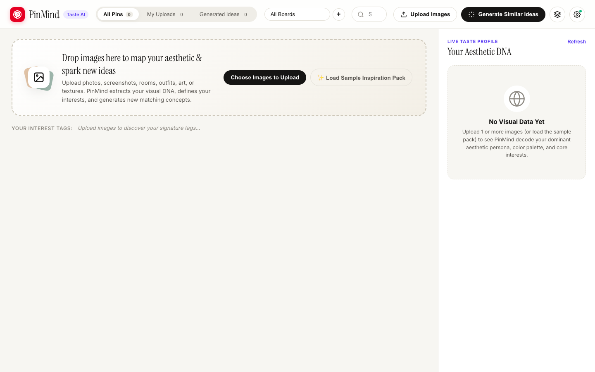

# PinMind — Personal Visual Discovery & Interest Engine

🚀 **[Live Demo](https://kylemath.github.io/pinmind)** 🚀

**PinMind** is a personal Pinterest and Aesthetic Taste Engine. Upload any set of images (interior spaces, architecture, outfits, objects, textures, or art) and PinMind analyzes their pixel-level color harmony, lighting, and visual metrics to define your core aesthetic interests and generate new matching visual ideas.

## Features

- **Pixel-Level Visual DNA Extractor:** Extracts dominant 5-color HEX palettes, warmth vs. coolness, brightness, saturation, and contrast directly in the browser.
- **Live Aesthetic DNA & Interest Profile:** Synthesizes your evolving aesthetic persona title, signature color palette proportions, visual spectrum bars, and ranked interest clusters.
- **Smart Idea & Pin Generator (Hybrid Mode):**
  - Works immediately offline/keyless by combining curated high-resolution photography with procedural editorial concept art rendered in your exact extracted color palette.
  - Optionally connect a **Google Gemini API Key** (`gemini-2.5-flash`) in Settings (`⚙️`) for live multimodal vision critique and custom concept synthesis.
- **Masonry Boards & Custom Collections:** Filter by *All Pins*, *My Uploads*, or *Generated Ideas*, organize pins into custom boards, search by tag or HEX code, and persist your collection automatically in `localStorage`.

## Running Locally

Open `index.html` directly in your browser, or serve the folder locally:

```bash
python3 -m http.server 8420
```
Then visit `http://localhost:8420`.

## Preview

<p align="center">
  
</p>

